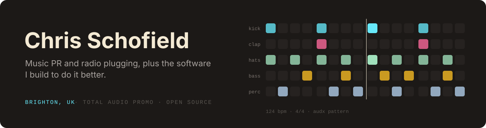
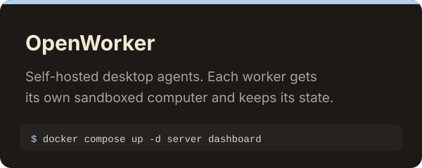
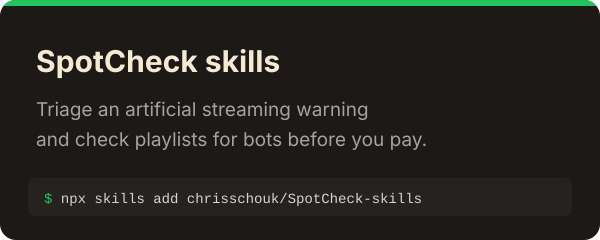
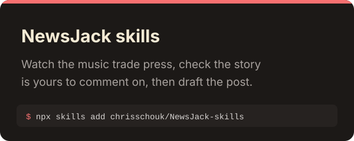
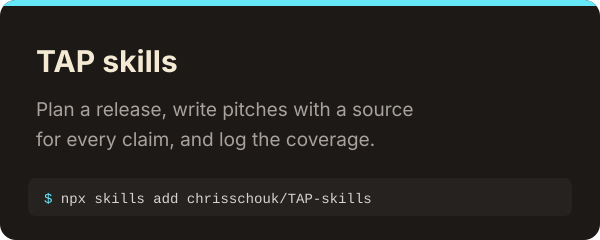
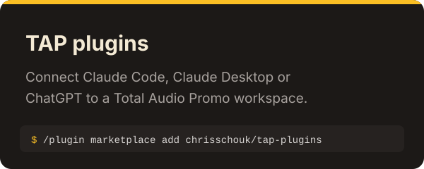
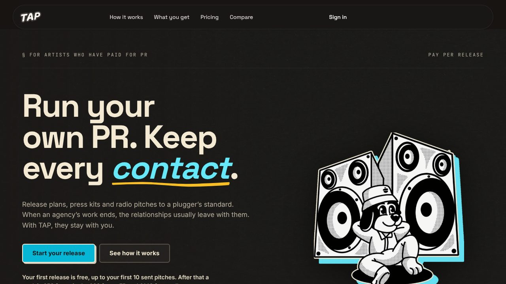
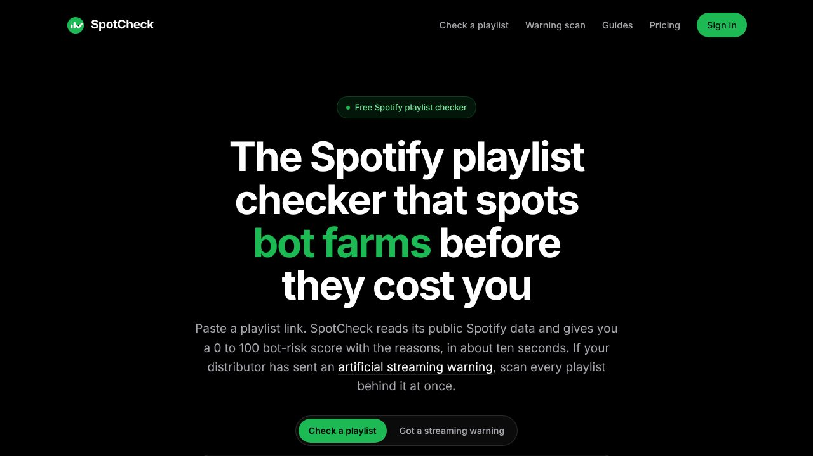
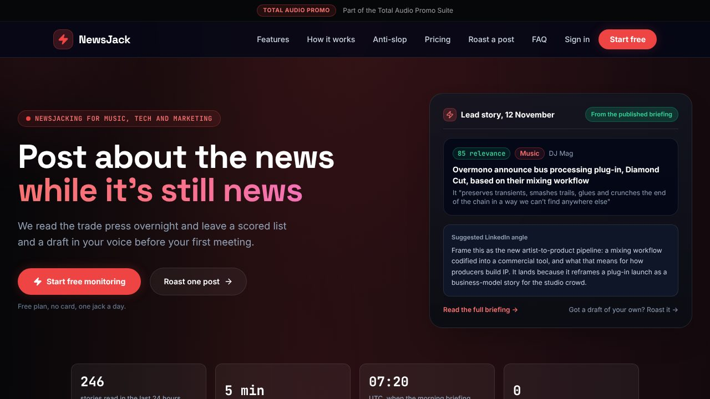

I run [Total Audio Promo](https://totalaudiopromo.com), a release platform for independent
artists, and plug radio campaigns for Liberty Music PR. Most of what's here started as a tool I
needed for a real campaign.

## audx

A terminal DAW. Write patterns like `kick 4/4` or `perc e(5,16,2)`, play them live from a Push 2,
then export the session as an Ableton Live Set. No install needed to try it:
**[type a beat in the browser](https://audx-five.vercel.app/play.html)**.

## Tools

<table>
<tr>
<td width="50%" valign="top">

<h3><a href="https://github.com/chrisschouk/sink-cli">datasink</a></h3>
Cleans music PR contact lists. Catches <code>bbc.com</code> when you meant <code>bbc.co.uk</code>, checks mail servers, merges duplicates and fills in outlet details.
  <code>npx datasink demo</code> · <a href="https://datasink.dev">browser version</a>
</td>
<td width="50%" valign="top">

<h3><a href="https://github.com/chrisschouk/podflow">podflow</a></h3>
Reads your Apple Podcasts library and writes a weekly digest of guests worth following and ideas worth keeping. Comes with an MCP server so agents can search it.
  <code>npx podflow init</code>
</td>
</tr>
<tr>
<td width="50%" valign="top">

<h3><a href="https://github.com/chrisschouk/tap-cli">tap-cli</a></h3>
Total Audio Promo from the terminal: campaigns, contacts, pitch drafts and outcomes. Pipe a cleaned datasink list straight in with <code>tap import</code>.
  <code>npm i -g @totalaudiopromo/tap-cli</code>
</td>
<td width="50%" valign="top">

<h3><a href="https://github.com/chrisschouk/open-desktop">open-desktop</a></h3>
An experiment in long-running agents. Each worker gets its own Docker desktop, with a REST API, CLI and MCP server on top, plus a playbook for finding music PR contacts.
</td>
</tr>
</table>

## Agent skills

Free skill packs for Claude Code, Codex, Cursor and anything else that reads `SKILL.md`. Each
one works without the product behind it.

<table>
<tr>
<td width="50%"></td>
<td width="50%"></td>
</tr>
<tr>
<td width="50%"></td>
<td width="50%"></td>
</tr>
</table>

## Products

<table>
<tr>
<td width="33%" valign="top">

<b><a href="https://totalaudiopromo.com">Total Audio Promo</a></b> 
Release plans, press kits and radio pitches for independent artists. An agent prepares the work and the artist approves every send.
</td>
<td width="33%" valign="top">

<b><a href="https://spotcheck.cc">SpotCheck</a></b> 
Paste a Spotify playlist link and get a bot risk score with the reasons, before you pay a curator.
</td>
<td width="33%" valign="top">

<b><a href="https://newsjack.cc">NewsJack</a></b> 
Reads the music trade press overnight and leaves a scored list and a draft post in your voice by morning.
</td>
</tr>
</table>

 

<a href="https://chrisscho.uk">chrisscho.uk</a> · <a href="https://totalaudiopromo.com">totalaudiopromo.com</a> · <a href="https://x.com/chrisschouk">X</a>

